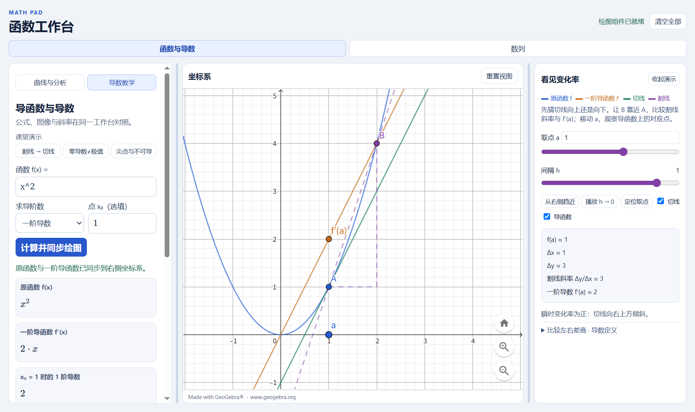

# Math Pad

PPT 旁的悬浮数学面板：用手写、键盘或 Python 数学表达式输入公式、绘制多条曲线、分析交点与圆锥曲线，并在同一个工作台演示导数与数列。当前版本 **0.5.2**，交付 **Windows 10 / 11 x64** 便携运行文件。

## 直接运行

1. 下载或克隆**整个 main 分支**，解压到可写目录。可使用 GitHub 的 **Code → Download ZIP**。不需要安装 Node.js、npm、Java 或额外的悬浮按钮。
2. 双击根目录 **`MathPad.exe`**。保留同级的 `portable-manifest.json` 和完整 `runtime/`；首次启动会校验并还原引擎。
3. 启动时默认在当前屏幕**左边缘中间**显示 f(x) 悬浮球。再次双击入口会展开悬浮球。点击悬浮球或托盘图标即可打开主面板。
4. 点「新增公式」输入并绘图。默认关闭主窗口时收起到托盘并保留本次图形，再点球或托盘即可回到原工作台。右键托盘选择「完全退出 Math Pad」可结束后台进程。
5. 点右上角「设置」可调整关闭、置顶、悬浮球、输入、绘图和导数演示偏好。修改后即时生效并保存在本机。

根目录入口和当前运行文件均随仓库提交，使用普通 Git 文件，不依赖 Git LFS。**Release 中既有的独立 ZIP 尚未更新**，请以 main 分支为准。

键盘输入、绘图、数列、求导和排版均可离线使用。**手写是 WIRIS 在线演示，需要联网，笔画会发送给 WIRIS。** 服务不可用时可切换键盘。微软数学输入面板已不再使用。

## 功能

- 多曲线共同绘图，可独立显隐、删除、二次编辑；求交点、零点、极值以及圆锥曲线的焦点、中心、顶点、准线或渐近线。
- Python 模式直接使用 `x**2`、`sin(x)`、`log(x, 2)`、`lambda x: ...` 与 `==` 二次方程；输入框下方提供完整语法表和可填入的示例，本地解析，无需安装 Python。
- 支持精确数列计算和 1 至 4 阶符号求导，保留分式与根式，检查点值的原式定义域。
- 原函数、导函数、切线和割线在左侧函数列表分组，拖动取点或播放 h → 0 时同步更新直线方程。可在「设置 → 导数教学」选择是否同时在导数表单下显示这组公式。
- 左右边栏可分别调整宽度；「清空全部」重置曲线、分析、教学动画和输入。

[功能、示例与支持范围](docs/FEATURES.md) · [Python 输入语法](docs/PYTHON_INPUT.md) · [环境要求、离线边界与自检](docs/COMPATIBILITY.md) · [开发和打包](docs/DEVELOPMENT.md)



## 仓库结构

```text
MathPad.exe                 Windows 根目录启动入口
portable-manifest.json      运行文件及 SHA-256 清单
runtime/                    唯一的当前运行版，含压缩引擎与第三方许可
src/                        Electron 主进程、悬浮球和界面源码
assets/                     应用图标
vendor/geogebra/             固定版本的官方离线绘图资源与校验清单
native/                     C# 启动器源码
scripts/                    构建、自检和集成测试
test/                       单元测试
docs/                       功能、开发、兼容性、许可和截图
.github/workflows/          干净 Windows 环境的自动验证
```

旧运行目录、构建产物、测试日志、引擎缓存和 `node_modules/` 均不上传。旧运行文件只在本机 `out/` 中保留备份。

## 校验与许可

无 Node.js 的电脑也可用 `MathPad.exe --verify` 检查清单文件；退出码 0 为通过，1 为缺失、损坏或清单无效，不会打开应用。详细命令见[兼容性说明](docs/COMPATIBILITY.md)。

本项目按个人与课堂**非商业教学原型**提供。GeoGebra 官方组件仍按其非商业条款使用；MathType Hand 的生产部署需要有效授权。当前启动器未作发行者代码签名；Windows 设备的应用控制策略仍可能影响运行。原创代码尚未选择开源许可证，仓库公开不等于所有组件都可自由商用。

[第三方声明](THIRD_PARTY_NOTICES.md) · [随包许可原文](docs/licenses/README.md) · [GeoGebra 官方许可](https://www.geogebra.org/license) · [MathType Hand 要求](https://docs.wiris.com/en_US/mathtype-html-generic-integration/embed-mathtype-hand-in-a-web-page)

Made with GeoGebra® · https://www.geogebra.org/
