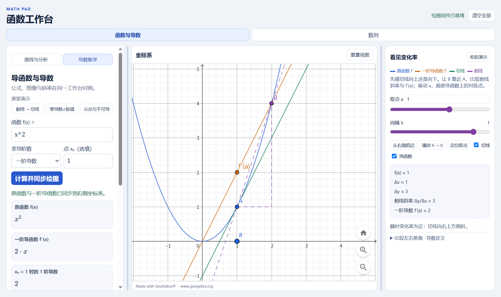

# 功能与输入说明

## 示例

| 操作 | 输入与结果 |
| --- | --- |
| 求交点 | 输入 `y=x^2`、`y=x+2`，勾选两条曲线，点 **求交点**，得到 `(-1, 1)` 和 `(2, 4)` |
| 椭圆焦点 | 输入 `x^2/25+y^2/9=1`，勾选曲线并选择 **焦点**，得到 `(-4, 0)` 和 `(4, 0)` |
| 双曲线渐近线 | 输入 `x^2/4-y^2/9=1`，勾选曲线并选择 **渐近线**，得到 `y=±3x/2` |
| 一般函数 | 可用 `sqrt(x)`、`abs(x)`、`exp(x)`、`ln(x)`、`log(2,x)`、`sin(x)` 等。数值求交按当前横轴范围计算，结果区显示使用的区间 |

键盘输入可用 `y=…`、`f(x)=…` 或直接输入关于 `x` 的表达式。二次方程可同时含 `x` 和 `y`。选择一条曲线可查看它的特性，选择两条可求交点。

在「新增公式」中切换「Python 表达式」，直接使用 `x**2`、`sin(x)`、`log(x, 2)` 等数学写法。具体语法直接显示在输入框下方，也可阅读 [Python 输入说明](PYTHON_INPUT.md)。Python 曲线与手写、普通键盘曲线共享坐标系、分析与二次编辑，并可直接进入导数教学。

每条曲线后有 **编辑** 按钮，打开后会带入原公式。保存成功后替换当前曲线，保留颜色、显示状态、列表位置和勾选状态，并重新计算关联的交点或曲线特性。取消、输入错误或绘图失败时保留原图。编辑教学曲线后会收起旧演示并标记旧求导结果，重新计算即可同步。

## 识别与绘图支持范围

手写面板下方出现公式预览，表示识别已经完成；随后仍需检查该公式是否在绘图支持范围内。当前支持显式函数和含 x、y 的二次方程，暂不直接接受含变量分母的分式隐式方程或一般高次隐式方程。

例如 `2/x^2+4/y^2=3` 能正确识别，但它不是椭圆方程。它在原式定义域内通分后含有四次项 x²y²。当前可按上下两支分别输入：

```text
y=2*abs(x)/sqrt(3*x^2-2)
y=-2*abs(x)/sqrt(3*x^2-2)
```

两支的实数定义域为 |x| > √(2/3)，保留原式的有效曲线，不把通分后可能出现的原点当作原式上的点。如果本意是椭圆，要区分 `x^2/2+y^2/4=3` 与分子、分母颠倒的式子，它们是不同的方程。

## 数列和导数

顶部可切换 **函数与导数 / 数列**，切换时保留各区输入和结果。函数工作台左侧可切换 **曲线与分析 / 导数教学**，右侧始终保留同一个坐标系。

- 数列支持等差、等比、已知通项和 `aₙ₊₁ = p aₙ + q` 的一阶线性递推。给出通项、前 n 项和、第 N 项、前 N 项和以及前 12 项预览。内置平方数列、裂项求和、错位相减和递推示例，并显示对应方法的关键步骤。
- 导数支持 1 至 4 阶符号求导，可输入一个点计算精确导数和切线方程。支持多项式、分式、根式、绝对值、指数、对数、三角与反三角函数及其复合，也支持 `x^x`。`a、b、c、k、m、n、p、q、r` 按常数参数处理。
- 点击 **计算并同步绘图**，会自动在右侧绘制蓝色原函数和橙色一阶导函数；选了高阶求导时，额外绘制所选阶的导函数。重复计算会替换上次教学曲线，保留其他手动添加的曲线。含未赋值参数的表达式暂不能直接绘图。三角函数使用弧度，`ln(x)` 为自然对数，`lg(x)` / `log(x)` 为常用对数，`log(2,x)` 为以 2 为底的对数。
- 分式、根式等优先保留精确结果，另列可计算的数值近似。求导展示所用的积、商、链式等规则；点值和切线会检查原式的分母、对数定义域和绝对值分界。分段函数及复杂分界点仍需人工判断，提示不会替代证明。

本地使用 [Nerdamer 2.0.1](https://nerdamer.com/docs/) 进行符号计算，使用 [KaTeX](https://katex.org/) 排版公式，二者都随运行包提供。**数列、求导和公式排版可离线使用**。计算在独立工作线程执行，可取消；超过 10 秒会停止并保留已有结果。

N 从 1 开始，最大 1000。一般通项优先尝试闭式求和；没有闭式时最多精确累加 100 项。部分通项会保留有限求和形式或提示不支持，不能保证任意递推和任意函数都有闭式结果。原式中的未定义项即使约分后消失，也会被拒绝。

## 导数动态教学

在 **导数教学** 中输入函数并计算，公式结果和图像同屏显示。也可先在曲线列表勾选一个普通函数，再点 **求导教学**。

动态演示控件集中在坐标系右侧的 **看见变化率** 边栏中，与左侧公式输入保持同样的纵向布局；可单独滚动或拖动分隔条调整宽度。



- 拖动横轴上的 **a** 点或取点滑块，观察 A=(a,f(a))、绿色切线，以及橙色导函数上高度为 f′(a) 的对应点。精确点值卡片对应计算时输入的 x₀；动态演示的 a 可单独移动。
- 紫色割线连接 A 和 B=(a+h,f(a+h))，直角辅助线表示 Δx 和 Δy。调整 h，或播放 **h → 0**，对比差商 Δy/Δx 与一阶导数。动画使用非零的 h（最小 |h|=0.001），可切换左右趋近。
- 展开 **比较左右差商 · 导数定义**，查看两侧差商表和极限定义。当前点未定义、导数不有限或位于需要单独讨论的绝对值分界时，不自动显示该点切线。
- **割线 → 切线** 示例使用 x²；**零导数≠极值** 使用 x³；**尖点与不可导** 使用 |x|。先提出问题，再拖动或播放，让学生比较符号、图形和数值。

动态图中的斜率和值是数值近似，展示现象而不代替极限、可导性和区间单调性的证明。切线始终依据一阶导数，即使上方选择了二至四阶求导。修改函数后会收起旧演示，重新计算即可同步；收起演示会保留原函数和导函数曲线。
